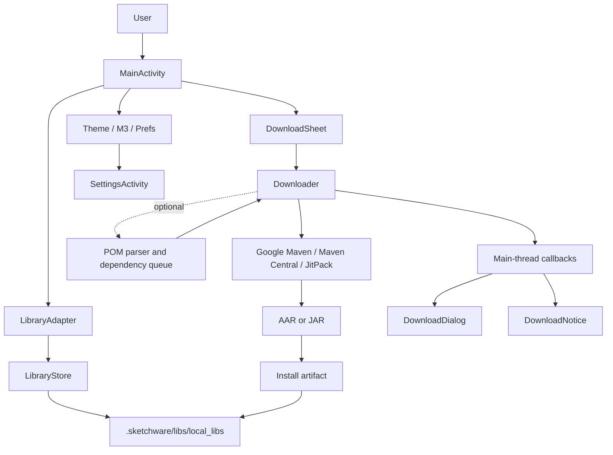

<div align="center">
  

  <h1>Cooperlib</h1>

  <p><strong>A focused Android companion for downloading and managing Sketchware libraries.</strong></p>

  <p>
    Resolve Maven coordinates · Download AAR/JAR artifacts · Extract Android libraries · Manage local libraries
  </p>
</div>

<div align="center">

[](https://github.com/Khaledhassan12/Cooperlib/actions/workflows/make.yml)
[](https://github.com/Khaledhassan12/Cooperlib/commits/main)
[](https://github.com/Khaledhassan12/Cooperlib)
[](https://github.com/Khaledhassan12/Cooperlib/stargazers)
[](https://github.com/Khaledhassan12/Cooperlib/network/members)
[](https://developer.android.com/)
[](https://openjdk.org/)
[](https://gradle.org/)
[](https://developer.android.com/build)
[](https://maven.apache.org/)
[-3DDC84?logo=android&logoColor=white)](https://developer.android.com/about/versions/lollipop)
[](https://github.com/Khaledhassan12/Cooperlib)

</div>

> [!IMPORTANT]
> **Project scope:** Cooperlib is a Sketchware library companion, not a general-purpose IDE, compiler, SQL workbench, or replacement for Gradle. The documentation below describes the implementation currently present in this repository. Planned ideas are identified separately from shipped functionality.

---

## 📚 Table of contents

- [Overview](#-overview)
- [What it does](#-what-it-does)
- [What it does not do](#-what-it-does-not-do)
- [Technology stack](#-technology-stack)
- [Architecture](#-architecture)
- [Maven coordinate format](#-maven-coordinate-format)
- [Dependency resolution](#-dependency-resolution)
- [Where libraries are stored](#-where-libraries-are-stored)
- [Application features](#-application-features)
- [UI and design system](#-ui-and-design-system)
- [Project structure](#-project-structure)
- [Build from source](#-build-from-source)
- [Continuous integration](#-continuous-integration)
- [Permissions and data access](#-permissions-and-data-access)
- [Security and engineering notes](#-security-and-engineering-notes)
- [Known limitations](#-known-limitations)
- [Contributing](#-contributing)
- [Roadmap ideas](#-roadmap-ideas)
- [Upstream project and attribution](#-upstream-project-and-attribution)
- [License](#-license)

---

## 🔎 Overview

**Cooperlib** is an Android application designed to simplify a specific part of the Sketchware workflow: obtaining Android libraries from Maven-compatible repositories and placing their files in Sketchware's local library directory.

Instead of manually searching for an artifact, downloading an archive, and extracting its contents, a user can enter a Maven coordinate such as:

```text
com.github.bumptech.glide:glide:4.16.0
```

The downloader searches the configured repositories, retrieves an available Android Archive (`.aar`) or Java Archive (`.jar`), and installs the result into the local library directory. An optional transitive mode reads Maven POM metadata and attempts to download compile/runtime dependencies as well.

The application also provides a local library browser, search, multi-selection, deletion, download progress feedback, and appearance settings.

### Project identity

| Item | Current repository value |
|---|---|
| Repository | [Khaledhassan12/Cooperlib](https://github.com/Khaledhassan12/Cooperlib) |
| Default branch | `main` |
| Package / namespace | `ru.iqwanoino.sketchlib` |
| Application label in AndroidManifest | `Sketchlib` |
| Application version | `0.21` |
| Version code | `4561` |
| Minimum Android version | Android 5.0 / API 21 |
| Compile SDK | API 33 |
| Target SDK | API 28 |
| Upstream parent | [IqwanXD/Sketchlib](https://github.com/IqwanXD/Sketchlib) |

The repository name is **Cooperlib**, while the current application package and visible application branding still use **Sketchlib** identifiers inherited from the upstream project.

---

## ✅ What it does

### 📦 Maven artifact downloads

- Accepts simple Maven coordinates in `group:artifact:version` form.
- Accepts common Gradle-style prefixes: `implementation`, `api`, `compileOnly`, and `compile`.
- Searches Google Maven, Maven Central, and JitPack.
- Checks for an AAR before a JAR in each repository.
- Downloads artifacts over HTTPS.
- Shows download status and byte-based progress when the server reports a content length.
- Supports cancellation while downloading.
- Can minimize the in-app progress dialog while the download continues in the application process.
- Posts progress and completion notifications when notification permission and system notification settings allow them.

### 🧩 Optional transitive dependency downloads

When **Include transitive dependencies** is enabled, Cooperlib reads Maven POM metadata and attempts to resolve dependencies that have:

- A `compile` or `runtime` scope, or no explicit scope.
- A non-optional declaration.
- A usable version, either directly declared or found in the parsed `dependencyManagement` section.

The implementation processes the dependency queue breadth-first and keeps the first encountered version for each `group:artifact` key.

This is a lightweight resolver. It is **not** a full implementation of Maven or Gradle dependency resolution. See [Dependency resolution](#-dependency-resolution) and [Known limitations](#-known-limitations).

### 🗂️ Local library management

- Reads the Sketchware local library directory.
- Displays library names and available metadata.
- Filters the visible list by name, version, and description.
- Supports long-press multi-selection.
- Supports selecting all currently visible entries.
- Confirms before deleting selected library directories.
- Supports pull-to-refresh of the local directory listing.

### 🎨 Appearance and interaction

- Dark and light appearance modes.
- Android 12+ system dynamic colors.
- A user-selected accent color.
- A custom color picker with hue, saturation/value, and hexadecimal input.
- Custom bottom sheets, drawer gestures, progress indicators, switches, checkboxes, and input fields.
- A collapsing settings header that responds to scroll position.

---

## 🚫 What it does not do

The current repository does not contain an implementation of the following systems:

| Area | Current status |
|---|---|
| Java/Kotlin/Python/C++ code editor | Not implemented |
| Syntax highlighting or code intelligence | Not implemented |
| SQL editor, SQL console, or database browser | Not implemented |
| Programming-language compiler | Not implemented |
| Gradle build execution for user projects | Not implemented |
| IDE project creation or project import | Not implemented |
| Debugger, profiler, or test runner | Not implemented |
| Language server protocol (LSP) integration | Not implemented |
| Android Studio or VS Code extension | Not implemented |
| AI coding assistant | Not implemented |

There are editor-related preference accessors in `Prefs.java` (line numbers, current-line highlighting, auto-indent, word wrapping, bracket pairing, and font size). However, the current application screens do not provide a code editor that consumes these settings. They should be treated as dormant preference scaffolding, not advertised editor functionality.

---

## 🧰 Technology stack

The badges below describe technologies found in the project or its build configuration—not a list of languages or tools supported inside the application.

<div align="center">

[](https://developer.android.com/)
[](https://openjdk.org/)
[](https://developer.android.com/studio)
[](https://gradle.org/)
[](https://developer.android.com/guide/topics/resources)
[](https://github.com/features/actions)

</div>

| Component | Implementation |
|---|---|
| Application language | Java |
| Android application plugin | Android Gradle Plugin 8.13.1 |
| Build system | Gradle 8.13 |
| Android compile SDK | 33 |
| Minimum SDK | 21 |
| Target SDK | 28 |
| Android UI | Native Android Views and custom Java View classes |
| Styling | Custom Material 3-inspired color tokens, surfaces, and interactions |
| Local settings | Android SharedPreferences |
| Maven metadata | `org.json` and Java XML DOM APIs |
| Archive handling | `ZipInputStream` |
| Network | `HttpURLConnection` over HTTPS |
| CI | GitHub Actions |
| Resource formats | Android XML, PNG, and a bundled TTF font |

### Dependency footprint

The application module currently declares only a local JAR file collection:

```groovy
dependencies {
    implementation fileTree(dir: 'libs', include: ['*.jar'])
}
```

No external Material Components, AndroidX UI, networking, database, or dependency-injection library is declared in the application module. The UI components used by the app are implemented in this repository.

---

## 🏗️ Architecture

Cooperlib uses a small, activity-driven architecture with separate classes for the UI, local library metadata, filesystem operations, and Maven downloads.



### Main components

| Class | Responsibility |
|---|---|
| `MainActivity` | Builds the main screen, search, drawer, selection mode, refresh, and download entry point. |
| `DownloadSheet` | Collects the Maven coordinate, minimum API selection, and transitive dependency preference. |
| `Downloader` | Parses coordinates, contacts Maven repositories, reads POM files, downloads artifacts, and installs them. |
| `LibraryStore` | Resolves the local storage directory, lists library folders, checks storage access, and deletes entries. |
| `Library` | Reads library folder metadata and exposes name, version, description, type, API value, and size. |
| `LibraryAdapter` | Filters and displays library entries and maintains multi-selection state. |
| `DownloadDialog` | Displays download status, progress, minimize, and cancel controls. |
| `DownloadNotice` | Builds Android download progress and completion notifications. |
| `SettingsActivity` | Displays theme, dynamic color, accent color, app information, and external links. |
| `Prefs` | Stores application preferences using SharedPreferences. |
| `Theme` / `M3` | Supplies color tokens, dynamic palette selection, shapes, and system-bar styling. |
| `Ui` | Provides reusable native view construction, layout, tinting, font, inset, and animation helpers. |
| `Sheet` | Implements the modal bottom-sheet container, drag-to-dismiss behavior, and keyboard movement. |
| `PushDrawerLayout` | Implements the push-style navigation drawer and gesture-driven animation. |
| `SimpleSwipeRefreshLayout` | Implements pull-to-refresh and a custom animated loading indicator. |
| `FileUtil` | Provides filesystem, URI/path, and bitmap utility methods. |
| `SketchwareUtil` | Provides additional general-purpose Sketchware helper methods. |

### Design approach

The project is Java-first and uses Android platform Views directly. Several custom widgets are drawn and animated in Java rather than delegated to a third-party UI library.

The `M3` class contains the color palette and related visual helpers. On Android 12 and newer, the optional dynamic-color mode reads system accent and neutral colors. On older versions, the application uses its own generated or baseline palette.

The project is Material 3-inspired; it does not depend on the official Material Components library.

---

## 🧾 Maven coordinate format

The primary input format is:

```text
group:artifact:version
```

Example:

```text
com.github.bumptech.glide:glide:4.16.0
```

The parser also recognizes these common Gradle-style forms:

```groovy
implementation 'com.github.bumptech.glide:glide:4.16.0'
api("com.github.bumptech.glide:glide:4.16.0")
compileOnly 'com.example:some-library:1.2.3'
compile 'com.example:legacy-library:2.0.0'
```

The input is normalized before validation. Group and artifact components accept letters, numbers, underscores, periods, and hyphens. Versions additionally accept plus signs.

### Input constraints

- Exactly three coordinate sections are required.
- Classifiers and explicit artifact extensions are not accepted as separate coordinate fields.
- Version ranges and Gradle version catalogs are not implemented. Although `+` is accepted by the character validator, dynamic versions are not resolved; the value is treated as a literal version path.
- The parser does not evaluate Gradle expressions, variables, functions, or project-specific configuration.

---

## 🔗 Dependency resolution

### Repository search order

The downloader checks these repositories in this order:

| Priority | Repository | Base URL |
|---:|---|---|
| 1 | Google Maven | `https://dl.google.com/dl/android/maven2/` |
| 2 | Maven Central | `https://repo1.maven.org/maven2/` |
| 3 | JitPack | `https://jitpack.io/` |

For each repository, the downloader checks for an AAR first and then a JAR. When transitive mode is enabled, it also attempts to retrieve the corresponding POM.

The first repository that matches the lookup condition is selected. This is a simple ordered lookup strategy, not repository aggregation or Gradle's variant-aware resolution.

### AAR and JAR handling

| Artifact | Current installation behavior |
|---|---|
| AAR | Extracted into a directory named `artifact-version`. |
| JAR | Copied to a file named `artifact-version.jar`. |
| POM | Read as metadata when transitive mode is enabled; it is not installed as a library. |

### Transitive dependency behavior

The current POM reader:

1. Parses the artifact POM.
2. Attempts to load parent POM metadata, up to a maximum parent depth of six.
3. Merges parent properties, managed versions, and dependency declarations.
4. Reads local `properties` and `dependencyManagement` entries.
5. Substitutes a limited number of Maven property placeholders.
6. Includes non-optional compile/runtime dependencies with resolvable versions.
7. Adds unseen `group:artifact` keys to a breadth-first queue.

Unresolved non-root dependencies are skipped. Consequently, a successful root download does not prove that every transitive dependency was installed.

### Resolver behavior that developers should know

The current implementation does not provide full Maven or Gradle semantics. In particular, it does not implement complete handling for:

- Maven BOM imports and imported dependency-management models.
- Dependency exclusions.
- Classifiers and arbitrary artifact types.
- Gradle module metadata and variant selection.
- Version ranges and dynamic version selection.
- Full conflict mediation and explicit nearest/highest-version strategies beyond the first-seen rule described above.
- Repository metadata and timestamped snapshot resolution.

Treat the transitive mode as a convenience feature for straightforward POM files—not as a drop-in replacement for a project's Gradle dependency resolver.

---

## 📁 Where libraries are stored

The local library root is hard-coded in `LibraryStore.REL_DIR`:

```text
/sdcard/.sketchware/libs/local_libs
```

### AAR directory layout

A downloaded AAR is extracted into a directory similar to:

```text
/sdcard/.sketchware/libs/local_libs/
└── glide-4.16.0/
    ├── AndroidManifest.xml
    ├── classes.jar
    ├── R.txt
    ├── res/
    ├── libs/
    ├── assets/
    ├── jni/
    ├── proguard.txt
    ├── lib.json
    └── sketchlib.json
```

The exact files depend on the downloaded AAR. The metadata files are generated by Cooperlib:

**`lib.json`**

```json
{
  "name": "glide",
  "version": "4.16.0",
  "description": "com.github.bumptech.glide · Google Maven"
}
```

**`sketchlib.json`**

```json
{
  "source": "com.github.bumptech.glide:glide:4.16.0",
  "repo": "Google Maven",
  "min_sdk": 21
}
```

The values above illustrate the metadata schema; the actual repository name and coordinate depend on the download result.

### JAR file layout

A JAR is copied as a file:

```text
/sdcard/.sketchware/libs/local_libs/
└── some-library-1.2.3.jar
```

> [!WARNING]
> **JAR listing caveat:** the current `LibraryStore.loadAll()` implementation adds directories to the library list and skips regular files. The downloader can write a JAR file, but the current in-app browser will not display that JAR as a library entry. This behavior should be addressed before describing JAR browsing as supported.

### Minimum API metadata

The download sheet lets the user select an API value from 21 through 34. For AAR downloads, the selected value is written to `sketchlib.json` as `min_sdk`.

This is metadata storage only. The current downloader does not inspect the AAR manifest to verify compatibility and does not enforce the selected API level. The JAR installation path does not currently write the same metadata files.

---

## 📱 Application features

### Main library screen

- Lists library directories found under `local_libs`.
- Shows the library name, optional description and version, available minimum API metadata, type, and approximate size.
- Filters the list as the user types.
- Clears the search query with a dedicated action.
- Enters multi-selection mode on a long press.
- Selects or deselects all currently filtered entries.
- Presents a confirmation before deletion.
- Refreshes the directory listing with a pull gesture.

### Download workflow

1. Open the download sheet.
2. Enter a Maven coordinate.
3. Select the minimum API metadata value.
4. Enable or disable transitive dependency downloads.
5. Start the download.
6. Follow status and progress in the dialog or notification.
7. Cancel the active operation, or minimize the dialog while the app process continues working.

### Settings

The current settings screen contains:

- Dark theme toggle.
- Light theme toggle.
- Android 12+ dynamic color toggle.
- Custom accent-color selection.
- Application version information.
- Local library path information.
- Community and source links.

---

## ✨ UI and design system

Cooperlib includes a set of hand-built UI components. These are application implementation details and are not a standalone UI framework or a public compatibility promise.

| Component | Purpose |
|---|---|
| `M3` | Material 3-inspired palette, dynamic colors, color utilities, shapes, and toast styling. |
| `Theme` | Maps palette values to application-level theme fields. |
| `Ui` | Common text, icon, button, layout, ripple, font, inset, and transition helpers. |
| `Sheet` | Modal bottom sheet with drag handling and keyboard-aware movement. |
| `PushDrawerLayout` | Animated drawer that pushes and scales the content view. |
| `MaterialSwitch` | Custom-drawn switch with animated thumb and color transitions. |
| `MaterialCheckBox` | Custom-drawn checkbox with animated check state. |
| `InoInputLayout` | Floating-label input container with configurable colors and sizing. |
| `InoProgressBar` | Custom animated determinate and indeterminate progress bar. |
| `InoHuePicker` | Hue and saturation selection control used by the accent picker. |
| `InoSaturationValuePicker` | Value/brightness selection control used by the accent picker. |
| `ColorPicker` | Accent color dialog with visual picker and hex input. |
| `SimpleSwipeRefreshLayout` | Pull-to-refresh container and animated loading indicator. |
| `Fonts` | Loads the bundled font from `assets/fonts/sans.ttf`. |

### Icons and visual resources

The current resource directory includes icons for the operations and navigation elements already present in the app, such as:

- Navigation and back actions.
- Download and upload.
- Search, clear, and settings.
- Copy, cut, paste, save, undo, and redo.
- Selection, deletion, and confirmation.
- GitHub, Discord, and Telegram links.

These are application UI assets. There is currently no dedicated icon catalog for programming languages, IDEs, database systems, SQL dialects, compilers, or build tools.

---

## 🗃️ Project structure

The following is a high-level map of the current source tree:

```text
Cooperlib/
├── .github/
│   └── workflows/
│       └── make.yml
├── app/
│   ├── build.gradle
│   ├── proguard-rules.pro
│   └── src/
│       └── main/
│           ├── AndroidManifest.xml
│           ├── assets/
│           │   └── fonts/
│           │       └── sans.ttf
│           ├── java/
│           │   └── ru/iqwanoino/sketchlib/
│           │       ├── MainActivity.java
│           │       ├── SettingsActivity.java
│           │       ├── Downloader.java
│           │       ├── Library.java
│           │       ├── LibraryStore.java
│           │       ├── LibraryAdapter.java
│           │       ├── DownloadSheet.java
│           │       ├── DownloadDialog.java
│           │       ├── DownloadNotice.java
│           │       ├── AppSheets.java
│           │       ├── ColorPicker.java
│           │       ├── M3.java
│           │       ├── Theme.java
│           │       ├── Prefs.java
│           │       ├── Ui.java
│           │       ├── Sheet.java
│           │       ├── PushDrawerLayout.java
│           │       ├── SimpleSwipeRefreshLayout.java
│           │       ├── MaterialSwitch.java
│           │       ├── MaterialCheckBox.java
│           │       ├── InoInputLayout.java
│           │       ├── InoProgressBar.java
│           │       ├── InoHuePicker.java
│           │       ├── InoSaturationValuePicker.java
│           │       ├── FileUtil.java
│           │       ├── SketchwareUtil.java
│           │       └── Fonts.java
│           └── res/
│               ├── drawable/
│               ├── layout/
│               ├── mipmap-*/
│               └── values/
├── build.gradle
├── gradle.properties
└── settings.gradle
```

The repository currently has a single application module: `app`.

---

## 🛠️ Build from source

### Requirements

| Requirement | Version / value |
|---|---|
| JDK | 17 |
| Gradle | 8.13 |
| Android Gradle Plugin | 8.13.1 |
| Android SDK Platform | 33 |
| Android minimum platform | API 21 |
| Git | Current stable version |

Android Studio can be used as the development IDE. The repository itself is a standard Android Gradle project.

> [!NOTE]
> A Gradle Wrapper (`gradlew`, `gradlew.bat`, and `gradle/wrapper/`) is not currently committed. The commands below therefore assume that Gradle 8.13 is installed and available on your system PATH. The GitHub Actions workflow installs Gradle 8.13 explicitly.

### Clone the repository

```bash
git clone https://github.com/Khaledhassan12/Cooperlib.git
cd Cooperlib
```

### Build a debug APK

Make sure JDK 17, Android SDK Platform 33, and Gradle 8.13 are installed and configured.

```bash
gradle --version
gradle :app:assembleDebug
```

The generated APK should be located at:

```text
app/build/outputs/apk/debug/app-debug.apk
```

### Install on a connected device

With USB debugging enabled and a device authorized:

```bash
adb install -r app/build/outputs/apk/debug/app-debug.apk
```

### Build the release variant

```bash
gradle :app:assembleRelease
```

The project does not currently define a release signing configuration or an automated publishing workflow. Configure signing securely outside source control before distributing a production release.

---

## ⚙️ Continuous integration

The workflow is defined in:

`.github/workflows/make.yml`

### Trigger conditions

- Pushes to `main` or `master`.
- Pull request events.
- Manual execution through `workflow_dispatch`.

### Build pipeline

| Step | Action |
|---|---|
| 1 | Checks out the repository using `actions/checkout@v4`. |
| 2 | Installs Temurin JDK 17 using `actions/setup-java@v4`. |
| 3 | Installs Gradle 8.13 using `gradle/actions/setup-gradle@v4`. |
| 4 | Runs `gradle :app:assembleDebug --stacktrace`. |
| 5 | Uploads the generated debug APK using `actions/upload-artifact@v4`. |

The uploaded artifact is named:

`Sketchlib-debug`

### CI scope

The current workflow verifies that the debug APK can be assembled. It does not currently run:

- Unit tests.
- Instrumentation tests.
- Android Lint.
- Static security analysis.
- Release builds.
- APK signing.
- Store or release publishing.

A successful CI build is therefore a build check, not a complete quality or security certification.

---

## 🔐 Permissions and data access

The Android manifest declares the following permissions:

| Permission | Purpose |
|---|---|
| `INTERNET` | Connects to the configured Maven repositories to retrieve artifacts and POM files. |
| `READ_EXTERNAL_STORAGE` | Reads the external storage library directory on supported Android versions. |
| `WRITE_EXTERNAL_STORAGE` | Legacy write access, limited to Android 10 / API 29 and below. |
| `MANAGE_EXTERNAL_STORAGE` | Provides broad file access for the Sketchware library directory on Android 11+. |
| `POST_NOTIFICATIONS` | Allows download progress and completion notifications on Android 13+. |

### Storage behavior

The application directly targets:

`/sdcard/.sketchware/libs/local_libs`

On Android 11 and newer, the current implementation checks and requests the all-files access setting. On older supported versions, it uses legacy read/write storage permission checks.

This is a broad storage permission model. A future implementation should evaluate a narrower Storage Access Framework or another scoped-storage-compatible approach where the Sketchware integration permits it.

### Network behavior

The downloader's configured artifact repositories use HTTPS:

- Google Maven.
- Maven Central.
- JitPack.

The application also contains external links to community and source destinations. No user account or remote application backend is part of the current download workflow.

---

## 🛡️ Security and engineering notes

This section records source-level observations for maintainers. It is not a formal penetration test, runtime test, or security certification.

### Existing defensive measures

- Maven coordinates are checked against character patterns before being used to build repository paths.
- HTTP connections have explicit connection and read timeouts.
- Download cancellation is checked while the artifact stream is being copied.
- Network and download callbacks are posted to the main thread.
- AAR extraction uses canonical-path validation to block ZIP entries that resolve outside the destination directory.
- The downloader uses HTTPS repository URLs.
- The repository's GitHub Actions workflow requests only `contents: read` permission for its build job.

### Hardening work recommended

| Priority | Area | Observation and recommended direction |
|---|---|---|
| Critical | XML parser hardening | The POM parser uses a default `DocumentBuilderFactory` without explicitly disabling DTDs and external entities. Configure secure XML processing and reject external entity resolution. |
| High | Download integrity | Artifacts are not verified against repository checksums or signatures. Add checksum verification before installation. |
| High | Archive limits | ZIP extraction has path traversal protection, but no explicit compressed/decompressed size, entry-count, or expansion-ratio limits. Add safeguards against oversized or decompression-bomb archives. |
| High | Concurrent downloads | Downloads share a fixed cache file named `download.part`. Add a single-job coordinator or unique temporary files and synchronization to prevent overlapping operations from corrupting each other. |
| High | Atomic installation | Existing AAR directories are deleted before extraction into the final location. Extract into a staging directory, validate the result, and atomically replace the destination where possible. |
| Medium | Dependency resolution | Missing transitive artifacts are skipped. Surface an incomplete-dependency report instead of presenting the root artifact as an entirely complete installation. |
| Medium | Version conflicts | The first encountered version for a `group:artifact` key wins. Report conflicts and make the resolution strategy explicit. |
| Medium | Storage scope | Reassess the need for all-files access and document the exact files the app reads or changes. |
| Medium | Error reporting | Preserve useful HTTP and filesystem diagnostics while avoiding sensitive local path disclosure. |
| Medium | Cancellation | Extend cancellation checks to POM retrieval, archive extraction, and installation stages. |

### Important implementation caveats

1. **JAR visibility:** JAR files are copied into the local directory, but `LibraryStore.loadAll()` currently lists directories only.
2. **Partial extraction:** An invalid or interrupted AAR extraction can leave an incomplete target directory.
3. **No durable download worker:** Downloads run on a manually started thread. A notification is used for progress, but there is no foreground service or WorkManager job guaranteeing survival after process termination.
4. **No automated tests:** No test source sets are present in the current repository tree.
5. **No committed wrapper:** Build reproducibility depends on the locally installed Gradle version unless a wrapper is added.
6. **Localization:** Many visible strings are currently hard-coded in Indonesian in Java source files rather than centralized in Android string resources.

These observations are useful starting points for engineering work and should be rechecked as the implementation changes.

---

## ⚠️ Known limitations

The following limitations are visible in the current source tree:

- The app's package name and manifest label still identify it as Sketchlib.
- The local library browser lists directories, not standalone JAR files.
- The POM parser supports a subset of Maven metadata, not every Maven/Gradle dependency feature.
- The minimum API selector stores metadata; it does not validate artifact compatibility.
- AAR extraction is not transactional.
- Downloads are not protected by a global concurrency coordinator.
- The downloader does not perform cryptographic integrity verification.
- The application does not include a foreground download service or durable WorkManager job.
- The current CI pipeline builds a debug APK only.
- No automated unit, UI, or instrumentation tests are included.
- The visible UI text is not yet fully localized through Android resources.
- No SQL, code editor, compiler, debugger, or user-project build subsystem exists in this repository.

---

## 🤝 Contributing

Contributions are welcome, particularly improvements that preserve Cooperlib's narrow purpose and make library installation safer and more predictable.

### Good areas to contribute

- Secure POM parsing and XML entity restrictions.
- Download integrity verification.
- Safer archive extraction with resource limits.
- Atomic installation and rollback.
- Serialized or uniquely isolated download jobs.
- Better dependency conflict and missing-dependency reporting.
- JAR visibility and metadata support in the local browser.
- Scoped storage improvements.
- English string resources and localization support.
- Unit tests for coordinate parsing, POM handling, archive validation, and filesystem operations.
- Build reproducibility through a committed Gradle Wrapper.

### Contribution workflow

1. Fork the repository.
2. Create a focused feature or fix branch.
3. Keep changes scoped and avoid unrelated formatting churn.
4. Build with JDK 17, Gradle 8.13, and Android SDK Platform 33.
5. Add tests for new parsing, storage, or download behavior where practical.
6. Open a pull request with a clear explanation, test/build evidence, and any relevant compatibility notes.

### Engineering expectations

- Do not commit API keys, credentials, signing keys, or private repository tokens.
- Do not weaken ZIP extraction path validation.
- Treat remote POM and archive content as untrusted input.
- Keep network and filesystem operations off the main thread.
- Keep UI callbacks lifecycle-aware.
- Preserve compatibility with the declared minimum Android API unless a deliberate platform change is documented.
- Do not advertise a feature as implemented until it exists in the application and is covered by suitable verification.

---

## 🧭 Roadmap ideas

The following are **proposals**, not claims about current functionality.

### Downloader and library management

- Add a download queue with one active installation per storage destination.
- Use unique temporary files and atomic installation.
- Validate checksums before extracting or copying artifacts.
- Harden XML parsing and archive resource limits.
- Display the resolved dependency graph and version conflicts.
- Report skipped or unresolved dependencies.
- Add first-class JAR entries to the local library browser.
- Add update checks for already-installed libraries.
- Add a safe uninstall/rollback mechanism.

### Developer experience

- Add a Gradle Wrapper and reproducible build configuration.
- Add unit tests for coordinate parsing, POM parsing, and ZIP safety.
- Add Android Lint and static-analysis checks to CI.
- Move all visible strings into Android resources and provide English localization.
- Document the library metadata schema as a versioned contract.
- Add screenshots and a verified release process.

### Optional future integrations

A future, separately scoped extension could provide richer developer-oriented documentation or resource browsing for languages, IDEs, build systems, and databases. Such an extension should not be confused with the current Cooperlib application, which does not implement language tooling or SQL functionality.

---

## 🌱 Upstream project and attribution

Cooperlib is a fork of:

**[IqwanXD/Sketchlib](https://github.com/IqwanXD/Sketchlib)**

The current GitHub repository metadata identifies Sketchlib as the parent repository. The initial snapshot in this fork is identified as **Sketchlib 0.21**.

Please review the upstream project and its licensing terms before redistributing or reusing code. Keep original attribution notices intact when required by the applicable license.

---

## 📄 License

**No `LICENSE` file is currently present in this repository.**

The absence of a license file means this repository does not explicitly grant users permission to redistribute or modify its contents. Do not assume that the project is MIT-, Apache-2.0-, or GPL-licensed. Review the upstream project's license and obtain clarification from the relevant copyright holders before reusing or redistributing the code.

---

<div align="center">

**Cooperlib — a focused library workflow companion for Sketchware.**

<sub>Built with Java · Android · Gradle · Maven</sub>

</div>
